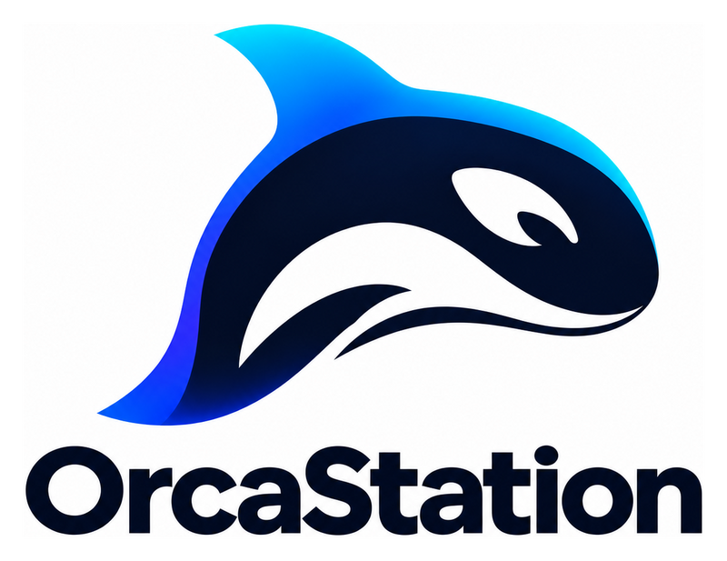
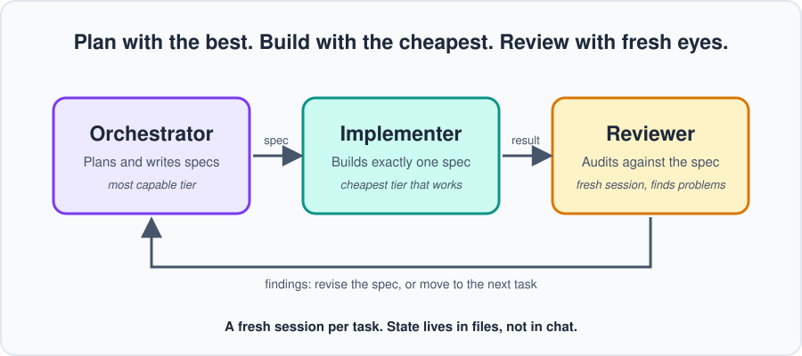

<p align="center">
  
</p>

# OrcaStation

**A model-agnostic guide and toolkit for orchestrating AI-assisted development.**
Spend your expensive tokens on thinking, not typing.

Maintained by the [AI Game Dev](https://aigamedevs.org) community.

[Website](https://aigamedevs.org) · [Discord](https://discord.gg/GGszfGZg8a) · [Start here](START.md) · [Guide](guide/README.md) · [Cheat sheet](CHEATSHEET.md) · [Worked example](examples/inventory)



---

## What is orchestration?

Orchestration means splitting a development job across **separate AI sessions with distinct roles**
(planning, building, reviewing) that are coordinated through **written handoffs** (specs, reports, reviews)
instead of one long conversation. Each job gets the level of capability it actually needs, and nothing is trusted
just because the session that produced it said so.

## The problem with one session and one model

Using a single model in a single session is simple, and it works for small jobs. On bigger ones, these problems
tend to show up. Some come from relying on one session, and some from relying on one model.

**From using one session**

- **The builder grades its own work.** When the same session writes the code and the tests, it can write tests that pass
  no matter what the code does, and it tends to agree with its own reasoning. The result can be a test suite that
  always passes without properly evaluating anything.
- **Bloated context.** A long session fills with history that the current task doesn't need. Important details get
  diluted, decisions get forgotten, and quality can drift.
- **State trapped in the conversation.** Decisions and plans live in chat. When the session ends or restarts, they're gone.

**From using one model**

- **One capability level for every task.** Planning and untangling ambiguity take a lot of capability. Following a clear
  instruction takes much less. A top-tier model on everything burns tokens without extra benefit on the easy parts, while a
  light model on everything struggles with the hard parts. No single choice fits every stage of development.
- **Shared blind spots.** A model reviewing its own work, or that of another session running the same model, tends to
  share the same assumptions and weaknesses, so it can miss the very mistakes it made. A different tier or model can catch
  different things.
- **One set of strengths and limits.** Every model is better at some things than others, and usage limits can stall all of
  your work at once. Relying on a single model leaves no flexibility or fallback.

## How OrcaStation addresses them

| Problem | What OrcaStation does |
|---|---|
| One capability level for everything | Match the tier to the task: your strongest model plans and writes specs, and the lightest model that reliably works builds ([Choosing tiers](guide/07-choosing-tiers.md)) |
| Builder grades itself | An independent reviewer in a fresh session checks the result against the spec |
| Bloated context | A fresh session per task, given only the spec and facts it needs |
| Lost state | Plans, specs, decisions, and handoffs live in files, not chat |
| Vague tasks | Small, specific specs, with parallel work only when files and interfaces don't collide |
| Shared blind spots | The reviewer runs in a fresh session, and can be a different tier or model so it doesn't share the builder's assumptions |
| One model's limits | Use several tiers (and vendors, if you like), so you can pick the right tool per task and keep working when one runs low |

> These are benefits observed in practice, not guarantees. Lighter models need tighter specs, and writing good specs
> costs orchestrator tokens. The guide covers the tradeoffs.

## The three roles

| Role | Job | Tier |
|------|-----|------|
| **Orchestrator** | Plans the project and writes precise specs | Most capable tier |
| **Implementer** | Follows one spec and builds it | Lightest tier that does it reliably |
| **Reviewer** | Independently audits the result against the spec | Strong tier, **fresh session** |

## When to use it, and when not to

**A good fit**
- Multi-step features and larger changes
- Work where correctness matters
- Projects that span many sessions
- Tasks you want to run in parallel

**Probably overkill**
- Typo fixes, renames, and tiny UI tweaks
- One-off scripts
- Early exploration, when you don't yet know what you want

**Outside its scope**
- It doesn't decide what you should build or replace your own judgment.
- It isn't a framework, an app, or an agent runtime.
- It doesn't cover deployment or security audits.

Orchestration has overhead. Use it when that overhead pays for itself.

## Start in five steps (Lite)

1. In a strong model's session (the orchestrator), describe your project and ask for a short plan.
2. Ask it for a small spec for the first task: what to build, which files, and how to check it.
3. Give that spec to a **fresh session** (the implementer). If you're new, use a model one step above the cheapest.
4. Give the spec and the result to **another fresh session** (the reviewer) and ask it to find problems.
5. Fix what it finds, then repeat for the next task.

Want copy-paste prompts for each step, or an agent-guided start? Use [START.md](START.md).

When you're ready for more, the full workflow adds `AGENTS.md`, branches, saved reports, parallel tasks, and metrics.
Start with the [guide](guide/README.md).

## The six principles

1. **One outcome per spec.**
2. **Specs carry the facts.**
3. **Tests first, and make them able to fail.**
4. **Define "done" mechanically.**
5. **Never let the builder grade itself.**
6. **Fresh session per task, state in files.**

## Works with anything

Bring your own models and subscriptions. OrcaStation doesn't depend on a specific model, vendor, or tool. It works with chat apps,
command-line and IDE agents, and parallel-agent environments, as long as your setup lets you run more than one session.
For dated examples with Claude and ChatGPT models, see [model examples](reference/model-examples.md).

## FAQ

**Do I need several different models?** No. One model in separate sessions still gives you fresh context and independent review.
Using different tiers is what adds the token savings.

**Do I need special software?** No. It's a set of files and a way of working.

**Is it only for game development?** No. It comes from a game dev community and the examples are game-flavored, but the method suits any software project.

**How much will I save?** It depends on your work, so we don't promise numbers. Chapter 11 shows how to measure your own.

## What's in this repo

```
OrcaStation/
├── README.md        You are here
├── START.md         Entry point with copy-paste playbooks
├── playbooks/       Step-by-step modes: Lite, new project, adopt, choose models
├── CHEATSHEET.md    One-page summary
├── LICENSE          MIT license
├── AGENTS.md        Drop-in instructions for agents
├── guide/           The full guide, chapter by chapter
├── templates/       Spec and review templates
├── examples/        A worked example, from spec to accepted
├── reference/       Dated model examples
└── assets/          Logo and diagrams
```

In the [worked example](examples/inventory), every automated check passed and the work was still wrong.
An independent review caught it.

## Status

First full draft. Start with the [guide index](guide/README.md), or jump to the [worked example](examples/inventory).

## Community

Questions, results, and war stories are welcome in the [AI Game Dev Discord](https://discord.gg/GGszfGZg8a).
If you try OrcaStation on a real project, we'd love to hear how it went.

## Contributors

Thank you to everyone who has tested OrcaStation and shared feedback. Your input directly improves the benefit this resource provides to the community.

- **ShinyStarSam**: First Tester/Feedback contributor.

Want to be listed? Try OrcaStation on a real project and share what worked and what didn't, in the [Discord](https://discord.gg/GGszfGZg8a) or as a GitHub issue.

## License

MIT. See [LICENSE](LICENSE).
