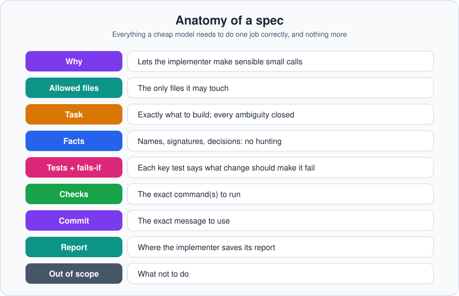

# Chapter 5: Writing a spec

**In one line:** a spec is everything a cheap model needs to do one job correctly, and nothing more.

The spec is the highest-leverage thing in this workflow. A good spec makes a cheap implementer look brilliant.
A vague one makes any model look bad.

## The anatomy



Every spec has these parts (the template is in `templates/spec.md`):

1. **Title and ID**
2. **Why:** one or two sentences on the purpose, so the implementer can make sensible small calls
3. **Allowed files:** the only files it may touch
4. **Task:** exactly what to build
5. **Facts:** names, signatures, constants, and decisions it needs (quoted from `decisions.md`)
6. **Verification:** the automated tests to write first (with a "fails if" line for the key ones), plus explicit acceptance checks for anything tests can't cover
7. **Checks:** the exact commands to run
8. **Commit:** the exact message
9. **Report:** where the implementer saves its report
10. **Out of scope:** what not to do

## A weak spec

> Add stack limits to the inventory.

The implementer has to guess: what limit, where, what happens when it's exceeded, which files, which tests.
Cheap models guess differently each time.

## A strong spec

```
# SPEC-003: Stack limits

## Why
Items should stack up to a maximum so inventories stay manageable.

## Allowed files
- src/inventory.py
- tests/test_stack_limits.py

## Task
In `Inventory.add(item, count)`: an item type stacks up to MAX_STACK (99).
If adding would exceed it, fill the existing stack to 99 and put the remainder in a new stack.
If no slot is free for the remainder, raise InventoryFullError and change nothing.

## Facts
- MAX_STACK = 99 (see decisions.md)
- Slots are a list; Inventory has `slots` (int) set at creation.
- `InventoryFullError` already exists in src/errors.py. Import it; don't redefine it.

## Verification: automated tests (write first; they must fail before you implement)
- adding 50 to a stack of 60 gives stacks of 99 and 11
  - fails if: the limit is changed to 100
- adding when all slots are full raises InventoryFullError and leaves slots unchanged
  - fails if: the code changes a stack before raising the error

## Checks
./check

## Commit
feat(inventory): add stack limits

## Report
Save to docs/reports/REPORT-003.md in the standard format, and commit it separately.

## Out of scope
Weight limits, saving, any refactoring.
```

## What makes it strong

- **Every ambiguity is closed.** The limit, the overflow behavior, and the error are all named.
- **Facts replace searching.** The implementer doesn't need to hunt for context.
- **Tests say what they guard.** Each key test states what change should make it fail, so the reviewer can check that it really would.
- **Boundaries are explicit.** Allowed files and out-of-scope lines prevent drift.

## When automated tests don't fit

Tests first is the default for behavior you can test. Some work has no meaningful automated test at the start: visual polish,
a prototype, documentation, subjective feel. Don't invent hollow tests to fill the gap. Name the verification instead, in the
spec's Verification section: a checklist of specific criteria, a screenshot to match, a build or lint result, or a person who
will judge it against stated criteria. Say what can't be verified. Be honest about the tradeoff: a manual check confirms the
task once, but it doesn't guard against future breakage the way an automated test does.

## Write specs just in time

Write the specs for the next phase, not the whole project. What you learn from finished work changes the
specs that follow (Chapter 4 explains the rhythm).

## Keep it short

A spec is not a design document. If yours is getting long, the task is too big. Split it.
Short, concrete specs finish more reliably than long, thorough ones.

## Do this

Write SPEC-001 for the first real task in your plan. Then ask a fresh session, "What's unclear or missing in this spec?"
Fix what it finds before handing the spec to an implementer.

**Next:** [Chapter 6: Implementing](06-implementing.md)
